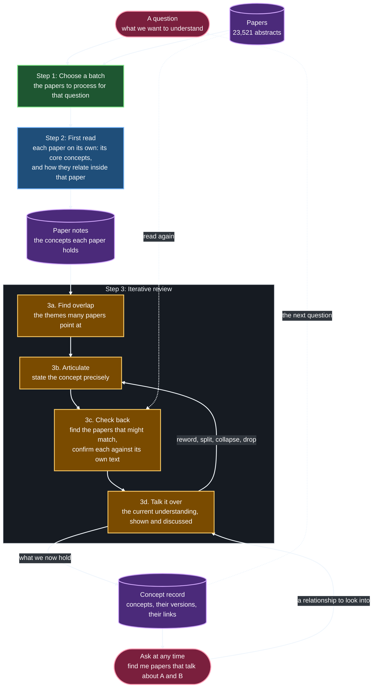
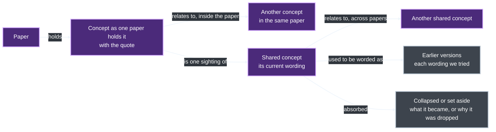
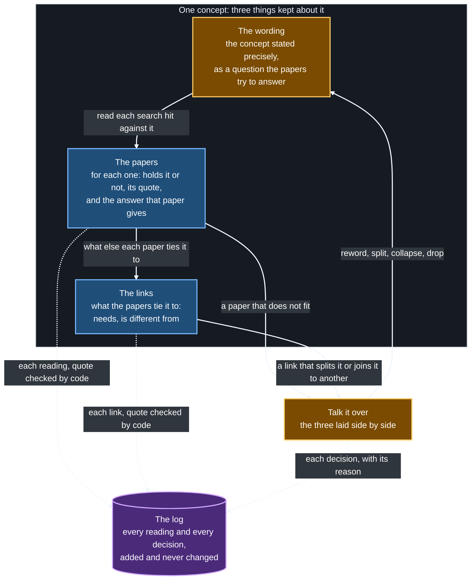

# Concept board: component map

Status: second sketch, 2026-11-17, with the proposals the owner agreed the same day ("Agreed
with the owner" below). Still a draft, and nothing here is built. The phase 7 spec
(`phase-7-literature.md`) stands, and the board comes after its tasks 4 to 9.

The aim: understand the key concepts in the harvested papers, how they relate to each
other, and how our statement of them changes as we learn. A batch of papers is chosen for a
question, each paper is read once on its own, and then the owner and Claude work the
results over together, in conversation, as many times as it takes.

What it is for (the owner, 2026-11-17): both the owner's own grasp of the field and a
record that can be audited. In the owner's words it is "a thought experiment in what more
advanced e-discovery of concepts might look like". How the board is audited is agreed in
outline (proposals 2 to 4 under "Agreed with the owner") and not built.

## The process

Colours say who does the work. Rose: the owner. Blue: a model reading alone. Amber: the
owner and Claude together. Green: code. Purple: something kept on disk.

## What we keep

Five things are modelled:

1. The concepts each paper holds.
2. How concepts relate to each other inside one paper.
3. How concepts relate to each other across papers.
4. The versions of a concept: every wording we tried, in order.
5. What fell by the wayside: concepts that were dropped, and concepts that collapsed (five
   that turned out to be one idea), each pointing at what it became.

## The parts

- **A question.** What we want to understand. It decides which papers are worth reading.
- **1. Choose a batch.** Picks the papers to process for that question: a word search
  inside what the screen kept (agreed 2026-11-17, proposal 5 below).
- **2. First read.** One paper at a time, with no knowledge of the others: what are this
  paper's core concepts, and how does the paper itself connect them?
- **Paper notes.** What the first read produces, kept per paper.
- **3. Iterative review.** Heavily human. It takes all the paper notes and goes round a
  loop:
  - **3a. Find overlap.** Which themes do many papers point at?
  - **3b. Articulate.** State the concept precisely.
  - **3c. Check back.** Search for the papers that might match the statement, and confirm
    each one against its own text. A paper that does not fit is evidence the wording is
    wrong.
  - **3d. Talk it over.** Claude shows the current understanding of the concept; the owner
    and Claude discuss it; the wording is revised, split, collapsed or dropped, and the
    loop goes round again.
- **Concept record.** What we currently hold, with the history of how we got there.
- **Ask at any time.** A question to the record, such as "find me papers that talk about
  concept A and concept B". The answer goes back into the conversation, usually to look at
  the relationship between the two.

## A first pass by hand: stopping rules (2026-11-17)

One concept taken once round the loop, to see what the record has to hold. Claude read the
abstracts in the session, not a pinned model, so the reading carries no model snapshot and
no prompt version; a logged entry for it would have to say so. The owner has not audited
the counts below: until he has, "12 of 31" is Claude's count and not a precision figure.
The wording of the concept is Claude's first draft and is not settled either.

The batch: the 31 abstracts whose text contains "stopping rule", "stopping criterion" or
"stopping method", found by a word search over `data/abstracts/`.

- 12 hold the concept in the sense of a document review: a rule that says when a
  model-ranked review may stop. 7 have it as their main subject and 5 use or mention it.
- 19 use the same words for something else: about 9 for a pre-registered study fixing when
  an experiment ends, about 7 for an agent or model loop, 3 for adaptive testing or a
  numerical method.

What it showed:

1. A word match is not a concept match: 12 of 31. The rejected papers are evidence too.
   They are what put "of a document review" into the wording, so the record should keep
   rejections and not only matches.
2. The papers disagree about the definition. Five stop on a recall target or on an estimate
   of what is left to find (`W4408528803`, `W4412394947`, `W7140358001`, `W7125413801`,
   `W7162694654`). Two reject that and stop when more review would not change the decision
   (`W7165025403`, `W7164002295`). The map has no place for rival definitions held at the
   same time: its versions are ours, in order. This is the "how each paper characterises
   it" of the third diagram.
3. Two links, each with a quote: the concept needs recall estimation (`W7162694654`), and it
   is a different thing from validation (`W7223334133`).

Quotes, each checked by code to be verbatim in the stored abstract:

- `W7140358001`: "aim to achieve a given target recall while examining as few documents as
  possible"
- `W7165025403`: "Most existing approaches focus on achieving a target recall, which does
  not consider whether an information need has been met."
- `W7164002295`: "do not take into account the reason for examining the results"
- `W7162694654`: "true recall is unknown during live screening unless all documents are
  judged"
- `W7223334133`: "is compatible with arbitrary stopping rules"
- Rejected, a pre-registered study, `W7172121649`: "tests, stopping rules, or failure
  rules."
- Rejected, an agent loop, `W7204885888`: "under explicit stopping conditions"
- `W7203824153`: "predefined stopping rules: (1) more than 10% of the dataset to be
  screened; and (2) 50 consecutive irrelevant titles and abstracts"
- `W7125413801`: "15 statistical or rule-based (heuristic) stopping methods"
- `W7165025403`: "monitor whether screened documents contain enough information to make a
  decision"
- `W4408528803`: "estimates the prevalence of relevant documents in the dataset"

Suggested by Claude on 2026-11-17, after the owner asked whether the concept is solid and
whether it can be a set of rules. Hold the concept as a question, "when may
the review stop?", with each paper's rule as one answer to it. The abstracts give at
least four answers: a target recall has been reached; an estimate says few relevant
papers are left; a run of irrelevant papers in a row has been seen; enough has been read
to make the decision. An answer can be a set of rules: `W7203824153` applies two, and its
abstract does not say whether both must be met. `W7125413801` compares 15 methods.

Settled for now (the owner, 2026-11-18): one concept. "Stop once enough has been found" and
"stop once more review would not change the decision" are rival answers to the one
question. That is Claude's call, kept by the owner: the papers argue with each other under
a single name. On 2026-11-17 the owner was not sure and could be persuaded that one or
both are necessary, so it is looked at again in December 2026
(https://github.com/nicolovejoy/elusion/issues/7).

## Agreed with the owner (2026-11-17 and 2026-11-18)

Proposed by Claude on 2026-11-17 and agreed by the owner, taken two at a time: 1 to 6 the
same day and 7 the next. The wording below is what was agreed, which for most of them is
more exact than what was first proposed; the first wording is in git.

1. The board sits on top of the screen and does not replace it. A systematic review runs
   screening, then data extraction (the first read), then synthesis (step 3). Tasks 4 to 9
   of the phase 7 spec stand and the board is built after them: a longer phase, not a
   different one. Once a concept is stated precisely the statement is a criterion, so
   precision and elusion can be measured for that concept by sampling. One criterion is
   one sieve: a question the criterion does not cover will find its papers in the discard
   pile.
2. Two kinds of entry, checked differently. A machine's reading is stored with its model
   snapshot and prompt version, and its quote is checked by code to be verbatim in the
   stored abstract; it is not promised to come out the same if run again. A decision by
   the owner and Claude (reword, split, collapse, drop) is stored with who, when, what
   changed, why and the evidence on the table; a person checks it by reading it. The pin
   works like a lot number on a part: it does not remake a reading, it finds every reading
   one model made. `docs/FIELD-NOTES.md` section 2 already has the shape: a concept
   version is immutable (its option A), a paper carries its history against a concept (B),
   and each change of wording is an approved, logged event (C).
3. The record is one append-only log holding both kinds of entry, and the board is a view
   computed from it. Versions, collapses and drops then come out of the log. The log is a
   Postgres table that takes only inserts. It is not a Kafka topic: the topic is the to-do
   list of work waiting to be done (`docs/ARCHITECTURE.md`), and a log of what was decided
   has to be asked questions, such as every line about one concept.
4. The test of "auditable" is "says who?". Every statement on the board has one of two
   answers: the paper says so, with a verbatim quote, or we decided so, with the logged
   decision and its reason. The board has no other source, so a statement with neither is
   refused, and code can check the whole board. The test catches a statement with no
   source, not a quote that was misread; that takes a person reading a sample ("Not
   decided yet", item 5).
5. Step 1 is two steps, because the corpus is mostly noise (5,941 abstracts mention "audit
   trail" and 1,696 mention blockchain): the screen once, for the subject, then a word
   search inside what the screen kept, once per question. The smaller pile is also what
   lets a search's misses be measured. With 300 abstracts read at random and none found,
   the Clopper-Pearson upper bound is 1.2%: up to about 290 still hiding among 23,490
   abstracts, and about 24 among 2,000 (a guess at what the screen keeps; it has not run).
6. "Done" is saturation, the word qualitative researchers use for the point where a new
   batch of papers yields no new concepts. It is counted per question, and it cannot be
   counted until the size of a concept is decided ("Not decided yet", item 2).

7. The board shows both histories. Ours comes from the log. The field's comes from each
   paper's publication date, which is already stored: for any concept, when the papers
   that hold it appeared. The corpus holds 2025 and 2026 only, and earlier years are not
   harvested for now. A paper dated January 1 is placed by its year alone, because that
   date usually means the month is not known: 1,857 of the 23,521 abstracts carry it, and
   January 2025 holds 709 abstracts where February holds 157. Looking up the actual date
   is tracked in https://github.com/nicolovejoy/elusion/issues/6. A concept's share of a
   month's papers says more than its count, since the corpus grows from about 200
   abstracts a month in early 2025 to about 2,000 in late 2026, partly from the search
   terms and from OpenAlex's indexing.

   As first proposed this said the field's change over time is not in the corpus. The
   owner said it should be tracked, and the dates were already there. An illustration from
   the first pass, in Claude's unaudited grouping and not a finding: the three fully dated
   papers that stop on a recall target or an estimate are from 2025-03, 2025-07 and
   2026-05, and the two that reject it are both from 2026-07.

## How one concept is reviewed

Asked for by the owner on 2026-11-17 and drawn on 2026-11-18: step 3 of the process
diagram, opened up for one concept. Three things are kept about a concept and they go
round together: its wording, how each paper characterises it, and how it relates to other
concepts.

Colours as in the first diagram: blue is a model reading alone, amber is the owner and
Claude together, purple is kept on disk. Solid arrows are the loop. Dotted arrows are what
is written to the log.

The three go round together because each can upset the others. A paper that does not fit
says the wording is wrong. A link can show that one concept is really two, or that two are
one. A new wording means the papers are checked against it again.

The stopping concept, as far as the first pass took it:

- **The wording:** "when may the review stop?", Claude's first draft.
- **The papers:** 31 contain the words and, by Claude's unaudited count, 12 hold the
  concept. They give at least four answers.
- **The links:** it needs recall estimation (`W7162694654`), and it is a different thing
  from validation (`W7223334133`).
- **One turn of the loop:** the papers about ending an experiment did not fit, and that put
  "of a document review" into the wording.

## Not decided yet

1. Settled 2026-11-18 (agreed proposal 7): both. The history of *our* understanding comes
   from the log, and the history of the *field's* thinking from each paper's publication
   date. Neither is on the diagrams above yet.
2. How big one concept is: a problem, a technique, a named theory, a school of thought.
3. Settled 2026-11-26 (the owner): a pinned model through the pipeline does the first
   read. See `phase-7-concept-audit.md`, "Decided by the owner, 2026-11-26".
4. How step 3c searches: by the words of the paper notes, or by rereading the abstracts.
5. How a concept or a link is checked, beyond tracing it to quotes.
