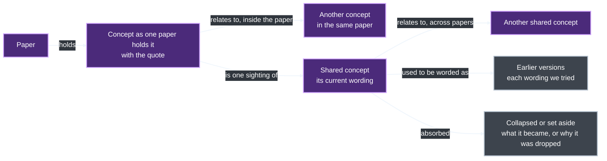

# Concept board: component map

Status: second sketch, 2026-11-17. A draft to iterate on. It changes nothing yet: the phase 7
spec (`phase-7-literature.md`) stands until the owner decides otherwise.

The aim: understand the key concepts in the harvested papers, how they relate to each
other, and how our statement of them changes as we learn. A batch of papers is chosen for a
question, each paper is read once on its own, and then the owner and Claude work the
results over together, in conversation, as many times as it takes.

What it is for (the owner, 2026-11-17): both the owner's own grasp of the field and a
record that can be audited. In the owner's words it is "a thought experiment in what more
advanced e-discovery of concepts might look like". How the board is audited is not designed
yet.

## The process

Colours say who does the work. Rose: the owner. Blue: a model reading alone. Amber: the
owner and Claude together. Green: code. Purple: something kept on disk.

## What we keep

Five things are modelled:

1. The concepts each paper holds.
2. How concepts relate to each other inside one paper.
3. How concepts relate to each other across papers.
4. The versions of a concept: every wording we tried, in order.
5. What fell by the wayside: concepts that were dropped, and concepts that collapsed (five
   that turned out to be one idea), each pointing at what it became.

## The parts

- **A question.** What we want to understand. It decides which papers are worth reading.
- **1. Choose a batch.** Picks the papers to process for that question.
- **2. First read.** One paper at a time, with no knowledge of the others: what are this
  paper's core concepts, and how does the paper itself connect them?
- **Paper notes.** What the first read produces, kept per paper.
- **3. Iterative review.** Heavily human. It takes all the paper notes and goes round a
  loop:
  - **3a. Find overlap.** Which themes do many papers point at?
  - **3b. Articulate.** State the concept precisely.
  - **3c. Check back.** Search for the papers that might match the statement, and confirm
    each one against its own text. A paper that does not fit is evidence the wording is
    wrong.
  - **3d. Talk it over.** Claude shows the current understanding of the concept; the owner
    and Claude discuss it; the wording is revised, split, collapsed or dropped, and the
    loop goes round again.
- **Concept record.** What we currently hold, with the history of how we got there.
- **Ask at any time.** A question to the record, such as "find me papers that talk about
  concept A and concept B". The answer goes back into the conversation, usually to look at
  the relationship between the two.

## A first pass by hand: stopping rules (2026-11-17)

One concept taken once round the loop, to see what the record has to hold. Claude read the
abstracts in the session, not a pinned model, so the reading is not repeatable; a logged
entry for it would have to say so.

The batch: the 31 abstracts whose text contains "stopping rule", "stopping criterion" or
"stopping method", found by a word search over `data/abstracts/`.

- 12 hold the concept in the sense of a document review: a rule that says when a
  model-ranked review may stop. 7 have it as their main subject and 5 use or mention it.
- 19 use the same words for something else: about 9 for a pre-registered study fixing when
  an experiment ends, about 7 for an agent or model loop, 3 for adaptive testing or a
  numerical method.

What it showed:

1. A word match is not a concept match: 12 of 31. The rejected papers are evidence too.
   They are what put "of a document review" into the wording, so the record should keep
   rejections and not only matches.
2. The papers disagree about the definition. Five stop on a recall target or on an estimate
   of what is left to find (`W4408528803`, `W4412394947`, `W7140358001`, `W7125413801`,
   `W7162694654`). Two reject that and stop when more review would not change the decision
   (`W7165025403`, `W7164002295`). The map has no place for rival definitions held at the
   same time: its versions are ours, in order. This is the "how each paper characterises
   it" of the third diagram.
3. Two links, each with a quote: the concept needs recall estimation (`W7162694654`), and it
   is a different thing from validation (`W7223334133`).

Quotes, each checked by code to be verbatim in the stored abstract:

- `W7140358001`: "aim to achieve a given target recall while examining as few documents as
  possible"
- `W7165025403`: "Most existing approaches focus on achieving a target recall, which does
  not consider whether an information need has been met."
- `W7164002295`: "do not take into account the reason for examining the results"
- `W7162694654`: "true recall is unknown during live screening unless all documents are
  judged"
- `W7223334133`: "is compatible with arbitrary stopping rules"
- Rejected, a pre-registered study, `W7172121649`: "tests, stopping rules, or failure
  rules."
- Rejected, an agent loop, `W7204885888`: "under explicit stopping conditions"

Open, and the owner's to decide: are "stop once enough has been found" and "stop once more
review would not change the decision" two concepts, or one concept with two rival
definitions? Asked 2026-11-17. The owner is not sure, and could be persuaded that one or
both are necessary. Claude leans to one concept, because the papers argue with each other
under a single name.

## Proposed by Claude, not agreed (2026-11-17)

1. The board sits on top of the screen and does not replace it. A systematic review runs
   screening, then data extraction (the first read), then synthesis (step 3); phase 7 part
   A built the first stage. Once a concept is stated precisely the statement is a
   criterion, so precision and elusion can be measured for that concept by sampling.
2. Two trails, different in kind. A machine's reading is reproducible: pinned model, prompt
   version, and a quote checked verbatim by code. A decision by the owner and Claude
   (reword, split, collapse, drop) is not reproducible, so it is logged: who, when, what
   changed, why, and the evidence on the table. `docs/FIELD-NOTES.md` section 2 already has
   the shape: a concept version is immutable (its option A), a paper carries its history
   against a concept (B), and each change of wording is an approved, logged event (C).
3. The record is an append-only log, and the board is a view computed from it. Versions,
   collapses and drops then come out of the log.
4. The test of "auditable": any statement on the board walks back to a verbatim quote or to
   a logged decision.
5. Step 1 needs a gate, because the corpus is mostly noise (5,941 abstracts mention "audit
   trail" and 1,696 mention blockchain): either the drafted screen, which is measured, or a
   search, which is cheap and not measured.
6. "Done" could be saturation, the word qualitative researchers use for the point where a
   new batch of papers yields no new concepts. It can be counted.
7. "Not decided yet" item 1 may settle itself: the harvest is 2025 and 2026 only (17,993 of
   the 23,246 harvested works are from 2026), so the field's change over time is not in
   this corpus.

## Next to draw

A third diagram, asked for by the owner on 2026-11-17: how one concept is reviewed
iteratively. It should show three things going round together: the definition and
description of the concept, how each paper characterises it, and how it relates to other
concepts. It is step 3 of the process diagram, opened up.

## Not decided yet

1. Which "change over time" we mean. The record above keeps the history of *our*
   understanding (versions, collapses). The history of the *field's* thinking, by
   publication date, is a different thing and is not on this map yet.
2. How big one concept is: a problem, a technique, a named theory, a school of thought.
3. Who does the first read: a pinned model through the pipeline, or Claude in the session.
4. How step 3c searches: by the words of the paper notes, or by rereading the abstracts.
5. How a concept or a link is checked, beyond tracing it to quotes.
